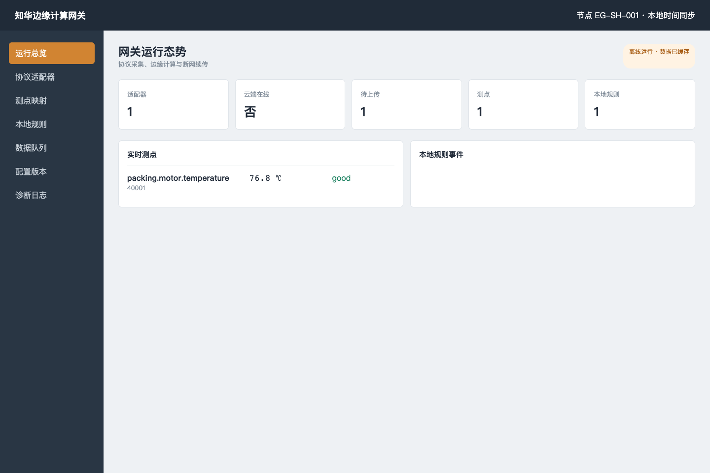

# 知华边缘计算网关（ZhuaTech Edge Gateway）

[简体中文](README.md) | [English](README.en.md)

面向工厂、楼宇、能源与物联网现场的轻量边缘运行时。它不把“已支持工业协议”写成一句空口号，而是把协议驱动放在明确的 Adapter 边界，社区版内置可运行的模拟适配器，完整实现测点归一、离线规则、事件、可靠 Outbox、云端确认和配置校验。

项目由[知华科技（上海如静知华信息科技有限公司）](https://www.zhuatech.cn/)维护。真实 OPC UA、Modbus、MQTT 驱动适配或商业授权，请微信添加 `zhuatech` 或 `zhuatech2`。



## 现场闭环

```text
协议适配器 → 地址/测点映射 → 缩放与质量码 → 本地规则
                                      ├→ 现场动作事件
                                      └→ 持久 Outbox → 云端 ACK
```

- 支持 `mqtt`、`modbus-tcp`、`opc-ua`、`simulator` 类型配置，真实协议包由适配器实现。
- 统一测点模型包含地址、单位、缩放、质量码和更新时间。
- `gt/gte/lt/lte` 本地规则在云端断开时仍执行。
- Store-and-forward 仅在 ACK 后标记完成，网络重试不会丢失。
- 配置修订必须递增并通过 SHA-256 校验，防止旧配置回滚。

## 验证

```bash
go test ./...
EDGE_API_KEY=zhuatech-demo-key go run ./cmd/gateway
```

访问 `http://127.0.0.1:18083/`。也可执行 `docker compose up --build`。

## 许可

仅允许个人学习、研究与交流，**不得商用**；企业生产、系统集成、交付、SaaS 与收费服务必须取得上海如静知华信息科技有限公司书面授权。该项目为带非商业限制的社区源码项目。

## 微信咨询

| 微信号 `zhuatech` | 微信号 `zhuatech2` |
| --- | --- |
|  |  |
